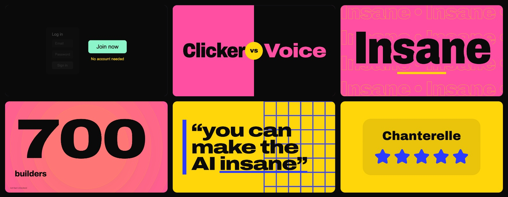
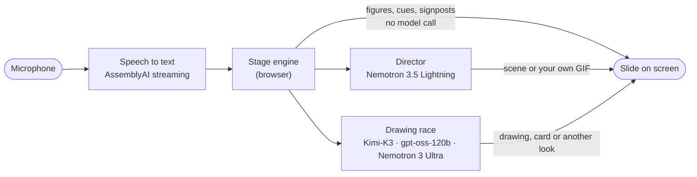

<div align="center">

<h1>DO IT LIVE</h1>

<h3>F*ck it, we'll do it live.</h3>

<p><b>Vibe presenting.</b> Walk on stage, start talking, and the slides draw themselves while you speak.<br>No deck. No clicker. No rehearsal.</p>

<p>
<a href="https://do-it-live-two.vercel.app"><b>Live demo</b></a> &nbsp;·&nbsp;
<a href="#how-it-works">How it works</a> &nbsp;·&nbsp;
<a href="#run-it-yourself">Run it yourself</a> &nbsp;·&nbsp;
<a href="docs/submission.md">Hackathon submission</a>
</p>

<p>


</p>



</div>

## Vibe presenting

Vibe coding took the boilerplate out of building software. Vibe presenting takes the deck out of giving a talk.

- **Talk, don't build.** There is no deck. What you say is the source, and you never touch a slide.
- **Show, don't tell.** A slide shows the point instead of repeating it: an interface, a number, a drawing, a duel, your own GIF. Never a paragraph.
- **Live means live.** Slides land mid-sentence. Now and then one misses. That is part of the show.

`#vibepresenting`

## What it does

- **Listens as you talk**, in English or Swedish, in any browser and on phones.
- **Decides every few words** whether this moment deserves a slide, without waiting for you to finish the sentence.
- **Puts the picture up in a second or two**:
  - a drawing streamed onto the screen as it is written;
  - one big interface element (a poll, a rating, a login that folds away);
  - a figure you just said;
  - moving type, or your own words quoted back.
- **Keeps it varied.** It never shows two interface cards in a row. It does not bring back a card type, or another look for a card, within a few slides. It skips pictures of what was just shown.
- **Plays your own media.** It finds the GIF or photo from your library that fits what you are saying.
- **Answers for you.** Say "Bill, how many…?" and it searches the web and puts up one slide with its source.
- **Runs anywhere**: a laptop on a projector, or a phone plugged into a TV.

## How it works



1. **Listen.** Audio streams to AssemblyAI (`universal-3-6-pro`), which returns words about a second after they are spoken. You pick the language under the mic.
2. **Read ahead without a model.** The stage engine acts on unfinished speech. Some things fire with no network call at all:
   - A figure you say ("700 builders", "80 percent") becomes a number slide the instant it is heard.
   - A signpost ("here's the problem") shortens the wait.
   - A prepared moment fires on its cue words.
3. **Decide and draw in parallel.** Every few words, two things happen at once.
   - **The director** (Nemotron 3.5 Lightning) judges whether the point deserves a slide.
   - **The drawing race** asks three models on Token Factory, and the first usable picture wins. Its first line is a verdict:
     - *same picture*;
     - *nothing to show*;
     - *an interface element*;
     - *a drawing*, which streams as HTML and CSS into a sandboxed iframe with no scripts.
   - **Two rules keep the race honest.** A quick "nothing to show" from a faster model never cuts off the best model while it is still drawing. A card that would be one too many becomes a big number, a duel, moving type or a quote instead.
4. **Prepare, if you want.** Write a few sentences about your talk beforehand. Nemotron 3 Ultra turns them into ready slides with cue words.
5. **Bring your own media.** Drop a whole folder. The file's own bytes say what it is (a "gif" from Giphy is often WebP or MP4), never its name. Nemotron 3.5 Super VL watches six frames of each, Tavily looks it up on meme and GIF sites, and Nemotron 3 Ultra decides what it is and what the internet uses it to say: "Blinking White Guy" means disbelief. A meme name is only kept when a page confirms it. Qwen3 Embedding then ranks the library against what you are saying.
6. **Ask for a fact.** Tavily searches the web, and Nemotron 3 Ultra turns the results into one sourced slide.

### NVIDIA models on Nebius Token Factory

| Job | Model | Why this one |
|---|---|---|
| Director: show or hold, which layout | `nvidia/Nemotron-3_5-Lightning` | Fast and steady enough to run every few spoken words |
| Preparing slides, sourced facts | `nvidia/Nemotron-3-Ultra-550b-a55b` | Serious reasoning where a second of latency is fine |
| Watching your own media | `nvidia/Nemotron-3.5-Super-VL` | Six frames spread over a GIF or clip |
| Naming it and its meaning | `nvidia/Nemotron-3-Ultra-550b-a55b` + Tavily | Meme, film or show, confirmed on a web page |
| Third runner in the drawing race | `nvidia/Nemotron-3-Ultra-550b-a55b` | A steady first token when shared models stall |
| Library ranking | `Qwen/Qwen3-Embedding-8B` | Embeddings on the same API |
| Drawing | `moonshotai/Kimi-K3`, `openai/gpt-oss-120b` | Raced with Nemotron 3 Ultra; the first answer wins |

**Where Token Factory sped us up.**
- **One API for everything.** Every call goes through a single OpenAI-compatible endpoint, `https://api.tokenfactory.nebius.com/v1`. Racing three drawing models or moving a role to another model is a change of model id, with no new SDK and no new keys.
- **Roles resolve at runtime.** Each role gets the best model available from `/models`, and `NEBIUS_MODEL_<ROLE>` overrides it.
- **JSON from Nemotron.** The reasoning models are called with `chat_template_kwargs: { enable_thinking: false }` so they return plain JSON.

Speech to text is the one part that does not run on Token Factory, which has no speech model yet. See the feedback in [docs/submission.md](docs/submission.md).

## Run it yourself

You need Node.js 22 (see `.nvmrc`) and a browser with a microphone.

```bash
git clone https://github.com/Baltsar/do-it-live.git
cd do-it-live
nvm use
npm install
```

Create `.env.local`:

| Variable | Needed | What it is for |
|---|---|---|
| `NEBIUS_API_KEY` | Yes | Every model call, through Nebius Token Factory |
| `ASSEMBLYAI_API_KEY` | Recommended | Speech to text that works in every browser and on phones |
| `TAVILY_API_KEY` | Optional | Sourced fact slides ("Bill, how many…?") |
| `SITE_PASSWORD` | Optional | A password in front of the whole app, API included |

```bash
npm run dev -- -p 3100
```

Open <http://localhost:3100>, pick **English** or **Svenska** under the mic, press the mic and talk. No microphone at hand? **Play the demo talk** replays a scripted talk through the same engine.

Without `ASSEMBLYAI_API_KEY` the app falls back to the browser's own speech recognition. That works in Google Chrome, Edge and Safari. Some Chromium browsers, Comet and Brave among them, ship the API with no service behind it; the app detects that and tells you.

### Pages

| Page | What it is |
|---|---|
| `/` | The show: mic, language, the live slide and caption |
| `/screen` | The audience window. Open it with **Screen** and drag it to the projector |
| `/style` | Your look: paste a website or drop a style guide, and the slides take its colours |
| `/library` | Your own photos, GIFs and clips |
| `/templates` | Every slide type, card and scene the engine can show |
| `/lab` | Engineering console: replays, logs, settings |

### On a phone

On a phone, **Screen** turns the phone itself into the audience screen: the slide alone, full screen. Plug the phone into a TV over USB-C and it mirrors, so you talk into the phone and the slides appear on the TV.

### The open demo and its limits

The hosted demo runs on our Token Factory credits, so each visitor gets `FREE_MINUTES` of stage time a
day (15) and the site has a daily ceiling (`DAILY_STAGE_MINUTES`, 180). The meter sits under the mic.
Run it yourself with your own key and there is no budget. How a show is priced after the hackathon:
[AFTER-THE-HACKATHON.md](AFTER-THE-HACKATHON.md).

### Deploy

`vercel deploy` works as is. `vercel.json` pins the Stockholm region. Set the same environment variables in the Vercel project.

On Vercel the disk is read-only, so two things change: the session recorder writes to the runtime log, and media uploads only work locally.

### See what happened in a show

Every show records what was heard, what each model answered, what reached the screen, how long it took, and every stretch where you talked and nothing new appeared. Locally the record lands in `sessions/`; on Vercel it goes to the runtime log.

```bash
node scripts/session-report.mjs              # the newest local show
node scripts/session-report.mjs saved.log    # or a saved Vercel log
```

The report prints the timeline, then four health numbers:
- how varied the looks were;
- the longest stretch with no new slide;
- how often a quick "nothing to show" overruled the best model;
- the time from words to screen.

## Project structure

```
src/lib/stage-engine.ts        The live loop: listening, deciding, the drawing race, timing, the session log
src/lib/director.ts            Director prompt, library and scene matching (server)
src/lib/draw.ts                Drawing prompt and streaming (server)
src/lib/card-looks.ts          Other looks for a card: big number, duel, moving type, quote
src/lib/stream-recognition.ts  AssemblyAI streaming client with an inline AudioWorklet
src/components/slide/          Slide renderer, interface cards, scenes and backdrops
src/app/api/                   Director, drawing, prep, speech token, library and session routes
scripts/session-report.mjs     Reads a recorded show and reports what happened
```

## Limitations

- Speech to text needs AssemblyAI or a browser with a working speech service.
- Drawing from unfinished sentences keeps the slides moving with the talk. The trade-off is that some pictures miss.
- English and Swedish are supported. Each other language AssemblyAI knows is one line in the language picker.
- Your own media: on a laptop the library is a folder on disk. Hosted, each visitor gets a private library in Vercel Blob, kept theirs by a random cookie; files go from the browser straight to Blob, up to 40 MB each.

## Built for

Built in Stockholm by [Gustaf Garnow](https://github.com/Baltsar) for the [Nebius × NVIDIA Global AI Hackathon](https://nebiusglobalaihackathon.devpost.com), **Best Apps and Agents** track.

The models run as a service on Nebius Token Factory, each under its own licence. Speech to text is AssemblyAI, web search is Tavily, and the interface uses shadcn/ui, Lucide and Motion.

## Contribute a picture

The engine's vocabulary is open: a scene, a look or an interface card is a small pull request. [CONTRIBUTING.md](CONTRIBUTING.md) has the three-file pattern and the back-row rules.

## License

[MIT](LICENSE)
